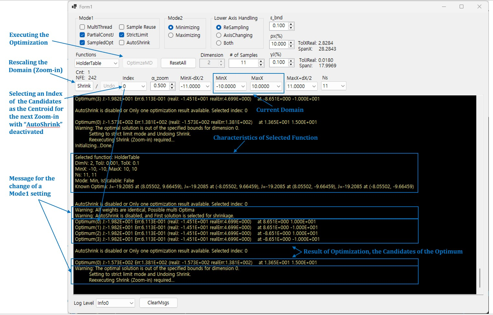

# OptNet: Multidimensional QSS Global Optimization Framework



**OptNet** is a GUI-based demonstration tool for the **Quadratic Sinusoidal Series (QSS)** multidimensional global optimization framework. It allows users to test, analyze, and benchmark the deterministic QSS-ND optimization algorithm across various standard benchmark functions.

## 📸 User Interface Overview

Below is the main user interface with key control groups and execution outputs annotated.

### UI Controls and Parameter Glossary

#### 1. Interactive Input & Execution Controls

| Group / Control | Description |
| ----- | ----- |
| **Mode 1 Group** | |
| `MultiThread` | Enables multithreading to accelerate optimization steps. *(Experimental)* |
| `Sample Reuse` | Includes previous sample data during resampling after a domain Shrink (Zoom-in). *(Under construction)* |
| `PartialConstJ` | Executes *Interval Isolation & Boundary Pruning*. Automatically deactivated when scale-disparity elimination criteria are satisfied. |
| `StrictLimit` | Prevents the newly shifted domain from exceeding the pre-zoom domain boundaries during Shrink. Automatically activated if the optimal solution escapes defined function limits. |
| `SampleOpt` | Displays both approximation-based errors and true objective function error metrics without adding to the NFE counter. |
| `AutoShrink` | Uses the computed candidate centroid as the center point for the next Zoom-in step (Enabled by default). Auto-deactivates if candidates share identical weights (suggesting multi-optima). |
| **Mode 2 Group** | |
| `Minimizing / Maximizing` | Selects whether to perform global minimization or maximization. |
| **Lower Axis Handling** | |
| `Resampling` | Calculates new sample points from approximated lower-axis samples *(Default)*. |
| `AxisChanging` | Swaps axis indices and executes lower-axis optimization using the primary axis methodology. |
| **Function & Domain Controls** | |
| `Functions` | Selects standard benchmark test functions (e.g., *HolderTable, Rosenbrock, Alpine, etc.*). |
| `Dimension` | Sets the input variable dimensionality ($d$). |
| `# of Samples (Ns)` | Sets the number of sampling points per axis ($N_s$). |
| **Hyperparameters** | |
| `γJ (%)`, `ρx (%)`, `α_zoom`, `ε_bnd` | Configures algorithm hyperparameters: energy selection threshold ($\gamma_J$), domain tolerance ($\rho_X$), zoom ratio ($\alpha_{zoom}$), and boundary buffer ($\epsilon_{bnd}$). |
| **Execution Controls** | |
| `OptimizeMD` | Runs the QSS optimization with current parameter settings. |
| `Shrink` | Performs domain Zoom-in around candidate solution centroids. |
| `Undo` | Reverts the last Shrink action (Single-step undo). |
| `ResetAll` | Resets all optimization logs, parameters, and domains back to default settings. |
| `Index` | Manually selects candidate index (0 to $N-1$) as the centroid when `AutoShrink` is disabled. |

---

#### 2. Read-Only / Computed Output Indicators (Status & Metrics)

The following fields cannot be directly edited by the user; they are automatically calculated and displayed based on the current domain state, hyperparameters, and execution history:

| Indicator Label | Description & Computation Formula |
| ----- | ----- |
| `SpanX` | **Read-Only:** Euclidean distance across the current domain extremes. |
| `TolXReal` | **Read-Only:** Calculated real domain tolerance ($TolXReal = SpanX \times \rho_X$). |
| `SpanJ` | **Read-Only:** Peak-to-peak difference among sampled objective function values ($J_{max} - J_{min}$). |
| `TolJReal` | **Read-Only:** Calculated real energy threshold ($TolJReal = SpanJ \times \gamma_J$). |
| `Cnt` | **Read-Only:** Total number of domain Shrink (Zoom-in) steps executed so far. |
| `NFE` | **Read-Only:** Total Number of Function Evaluations accumulated up to the current step. |
| `MinX / MaxX / Ns` | **Read-Only:** Displays current minimum, maximum, and grid size per axis. |

## 🚀 Basic Usage & Execution Procedure

Follow these step-by-step instructions to replicate benchmark results reported in the research paper:

1. **Select Objective Function:**
   * Choose a target function from the **Functions** dropdown menu.
   * Function details (dimension, known global optima, domain bounds, default settings) will display in the console log.

2. **Verify/Adjust Parameters:**
   * Check preset values for **Mode 1/Mode 2**, **Dimension**, $N_s$, and Hyperparameters ($\gamma_J, \rho_X, \alpha_{zoom}, \epsilon_{bnd}$). Default settings are aligned with paper benchmark setups.

3. **Execute Optimization:**
   * Click **`OptimizeMD`** to execute the initial QSS reconstruction and candidate funneling pass.
   * View optimal candidate locations, calculated metrics (`SpanX`, `TolXReal`, `SpanJ`, `TolJReal`), and accumulated `NFE` in the console window.

4. **Iterative Zoom-in (Shrink):**
   * Click **`Shrink`** to zoom in on the selected candidate centroid.
   * Repeat **`OptimizeMD`** $\rightarrow$ **`Shrink`** steps iteratively until the desired error tolerance or convergence threshold is met.
   * Use **`Undo`** if a domain shift requires parameter adjustment before re-running.

5. **Log Management:**
   * Adjust the **Log Level** dropdown to filter message verbosity.
   * Click **`ClearMsgs`** to clear the current output screen.

## 📦 Requirements & Installation

* **OS:** Windows 10 / 11 (64-bit)
* **Runtime:** .NET Framework 4.8 / .NET 6.0+ (depending on target runtime)
* **Build Tool:** Visual Studio 2022

### Quick Start

1. Clone this repository:
   ```bash
   git clone https://github.com/taishinKr/OptNet.git
   ```
2. Open `OptNet.sln` in Visual Studio and build in `Release | x64` mode.
3. Run `OptNet.exe`.